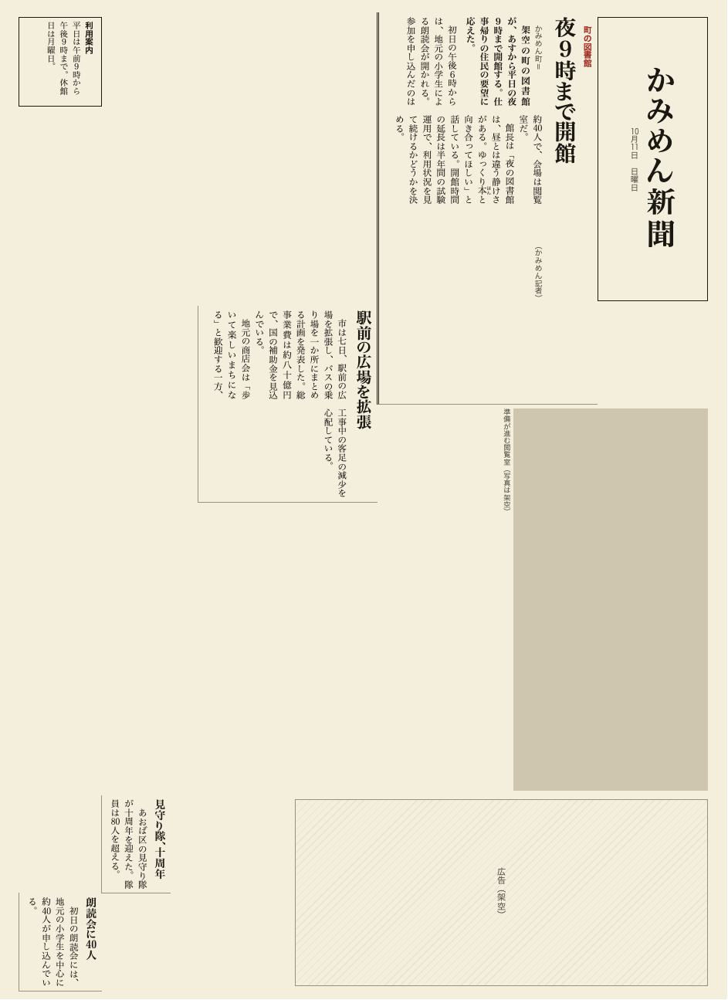
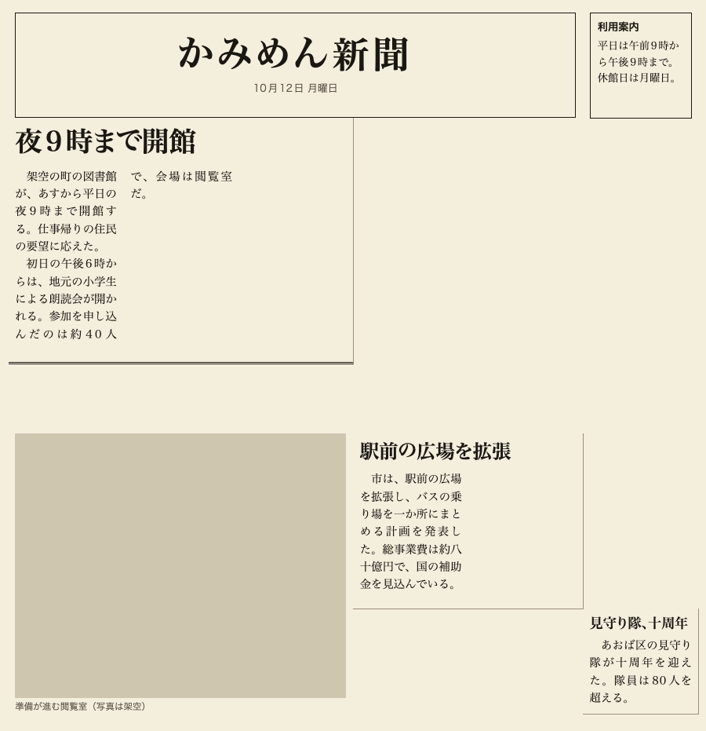

# shinbun-layout

Automatic page layout for Japanese newspapers (新聞の紙面), as a library. Give it articles, photos and boxes; it returns where each one goes on the column grid of [shinbun-css](https://github.com/kamimen/shinbun-css). It decides sizes and positions only; the text is measured by your host (a browser) and the answers are passed in.

<p>
  
  
</p>

## How it works

1. `required_measurements(problem)` says which sizes to measure: one question per item and column count (段).
2. Your host measures, in the browser that will draw the page, the least number of lines each item needs at each column count, and builds a table.
3. `solve(problem, table, options)` returns the placements. It is pure and deterministic: the same input and seed give the same layout.

The inputs and the output are JSON (full format in [docs/SPEC.md](docs/SPEC.md)). No text goes into the problem, only its length and how important the item is:

```json
{ "paper": { "writing": "horizontal", "dan": 6, "lines": 40, "chars": 10 },
  "items": [
    { "id": "n", "role": "nameplate", "priority": 10 },
    { "id": "a", "role": "article", "priority": 10, "chars": 95, "headline": "l", "lead": true },
    { "id": "p", "role": "photo", "priority": 6, "ratio": 1.73, "caption": true } ] }
```

The measurements, and the answer:

```json
[ { "id": "a", "span": 1, "lines": 18 }, { "id": "a", "span": 2, "lines": 11 }, … ]
```
```json
{ "layout": { "placements": [ { "id": "a", "x": 7, "w": 14, "y": 1, "span": 3 }, … ] },
  "unplaced": [], "warnings": [], "score": { "total": 55.6, … }, "alternatives": [ … ] }
```

`{x, w, y, span}` is the placement used by shinbun-css and shinbun-maker. Items that do not fit come back in `unplaced` with a reason, and style problems (シリモチ, 並列, エントツ, ハラキリ) come back as warnings. `validate()` checks any layout, whoever made it.

## Use it

From Rust:

```rust
let queries = shinbun_layout::required_measurements(&problem);
// measure `queries` in a browser and fill a MeasurementTable
let solution = shinbun_layout::solve(&problem, &table, &SolveOptions::default())?;
```

From JavaScript, through WebAssembly (`scripts/build-wasm.sh` writes `pkg/web` and `pkg/node`):

```js
import init, { requiredMeasurements, solve } from "./pkg/web/shinbun_layout_wasm.js";
await init();
const queries = JSON.parse(requiredMeasurements(problemJson));
const solution = JSON.parse(solve(problemJson, tableJson, ""));   // errors are thrown as strings
```

From the command line, or any language, with JSON files:

```sh
shinbun-layout measurements problem.json
shinbun-layout solve problem.json table.json
shinbun-layout validate problem.json table.json layout.json
```

`tools/measure` is a reference measuring host (Playwright and Chrome). `cargo run --example ascii` draws a built-in front page as text.

## Build

Build from source:

```sh
git clone https://github.com/kamimen/shinbun-layout
cd shinbun-layout
cargo build --release          # target/release/shinbun-layout
cargo test
scripts/build-wasm.sh          # needs the wasm32 target and wasm-bindgen-cli (the script says which version)
```

## Documentation

[kamimen.github.io/shinbun-layout](https://kamimen.github.io/shinbun-layout/): the JSON formats, how the layout is found, and the Rust API.

[日本語](README_ja.md)

## License

MIT
